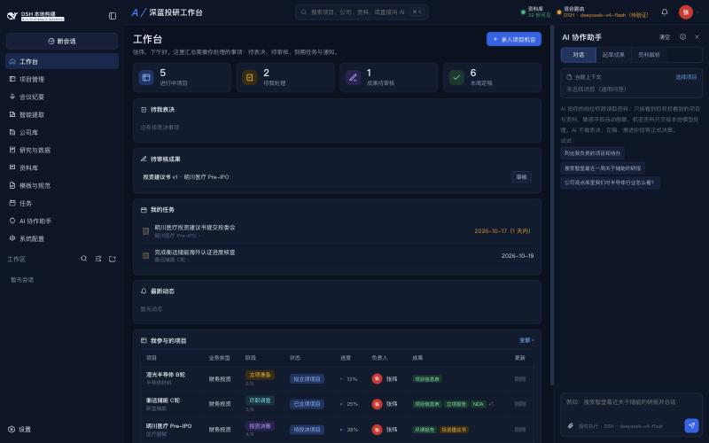
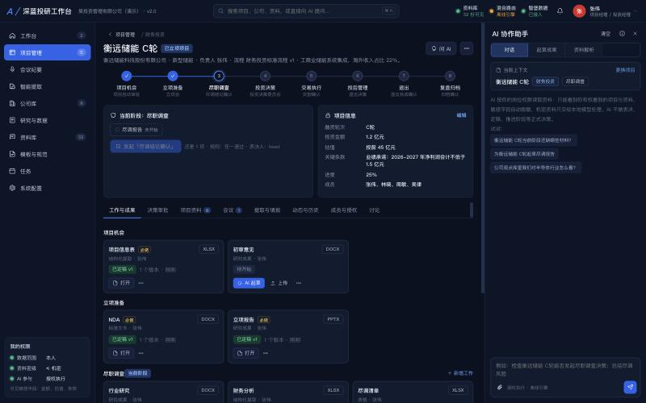

# 深蓝投研工作台 · InvestAI 2.1

投资管理机构的 AI 协作系统：项目按业务类型配置的流程推进，每个阶段有具体工作与准入条件，决策由有权人员表决；AI 在你的权限范围内检索资料、起草成果、提取数据、整理会议纪要，但**不做任何正式决策**。

同一套代码三种运行方式：**DSH 全局插件**（接管 DSH 外观与侧栏，复用 DSH 的 DeepSeek 模型）、**独立 SaaS**（多用户登录、统一登录、外部填报链接）、**本机演示**（单用户，可切换岗位身份）。



## 快速开始（Node ≥ 22.13）

```bash
npm install
```

| 方式 | 命令 | 说明 |
|---|---|---|
| DSH 插件 | `sh scripts/install-dsh.sh`，然后 `dsh web` | DSH 桌面版：设置 → 插件 → 添加本目录或 `release/investai-desktop-2.0.0.tgz`。在 DSH「设置 → 模型」填 DeepSeek API Key 后自动使用（优先 V4.1 Flash） |
| 本机演示 | `node server.mjs --desktop` | 打开 http://127.0.0.1:4310，右上角头像切换 15 个演示岗位 |
| SaaS | `DEEPSEEK_API_KEY=… node server.mjs` | 首次启动在数据目录生成 `initial-credentials.txt`（随机初始密码，权限 600） |
| 会议转写 | `sh scripts/setup-asr.sh` | 安装本机 faster-whisper small（约 480MB），录音不出本机 |
| 测试 | `node --test test/*.test.mjs` | 33 项回归与生命周期测试（代码审查发现的每个问题一条） |
| 验收 | `node scripts/verify.mjs` | 135 项自动化验收（临时目录，不碰真实数据） |
| 评测 | `node scripts/eval.mjs [--deepseek]` | 34 项 AI 质量与安全评测，结果在「系统配置 → 评测」 |

数据目录：插件 `~/.dsh/investai`，服务端 `./data`（`--data` 可改）。密钥（智堡、推送 Webhook、统一登录）只保存在 `~/.config/investai/secrets.json`（600），不进数据库、日志或安装包。

## 功能一览

| 需求 | 实现 |
|---|---|
| 一、可配置流程 | 7 类业务（财务投资为主线，另有并购重组、上市公司资本运作、基金、资本招商、产业投资、其他）。流程是结构化定义：阶段 → 具体工作（必做 = 准入条件）→ 决策节点（审批 / 上会 / 会签，任一 / 全体 / 过半 / 三分之二）。结果可推进、退回补充、继续持有、终止；另有暂停、恢复、重新推进、人工退回。流程有版本，发布不影响在途项目 |
| 二、四层权限 | 功能权限 · 数据范围（本人 / 本部门 / 指定授权 / 投后 / 全机构）· 业务操作（启动授权、材料定稿、上会表决、投决、交易确认、退出、归档）· 敏感字段（金额 / 估值 / 条款 / LP / 商业秘密）与资料密级（公开 / 内部 / 机密 / 绝密）。11 个预设岗位，可增改；AI 继承当前用户权限，文本自动脱敏 |
| 三、AI 参与边界 | 关闭 / 辅助建议 / 起草待确认 / 授权执行，按岗位、业务类型、工作类型、资料密级取最低值。AI 工具里没有表决、定稿、推进、删除、导出 |
| 三、模型路由 | 外部（DeepSeek）/ 本地（Ollama 等，仅本机回环地址）/ 混合。默认「机密」及以上只交给本地模型，无本地模型时用离线引擎（不调用任何模型） |
| 四、会议纪要 | 上传录音 → 本机转写（热词 + 术语校正）→ 讨论要点 / 决定事项 / 待办 / 责任人（只从参会人中识别）/ 期限 → 人工确认 → 纪要定稿入项目、待办生成任务 |
| 五、文档 | 标准文书（NDA、框架协议、交易文件）按 `{{字段}}` 模板填充，缺失标【待补充】；研究类成果由 AI 参考历史成果结构与写作规范先规划大纲、你确认后起草。真实 Word / PPT / Excel 文件，可用本机 Office 打开编辑后提交为新版本；每次修改都是新版本，可恢复、可撤回定稿；导出 PDF |
| 六、数据收集 | 外部自助填报：一次性授权链接（1–14 天、可撤销、只存哈希、附件白名单）；AI 从 BP / 工商 / 财报提取，人工确认后写入同一公司库，保留来源与确认人 |
| 七、固定格式转换 | BP → 项目信息表，财报 → 财务分析表（多期 + 衍生指标），尽调材料 → 尽调汇总。每个字段标来源与页码，缺失与多源冲突单独列出，审计口径优先于 BP，导出 Excel / PDF |
| 八、财务投资全流程 | 项目机会 → 启动审批 → 立项准备 → 立项会 → 尽调 → 投委会 → 交易执行 → 交割会签 → 投后 → 退出决策 → 退出 → 复盘归档（验收脚本逐步跑通） |
| 路线图 | 真实 DeepSeek + 评测集 · PDF 解析（含中文 CMap）· 智堡定时采集入库 · Word/PDF 导出 · 事件触发与 AI 预审 · 企业微信 / 飞书 / 钉钉推送（加签）· SQLite 服务端库 + 统一登录（OAuth2 + PKCE）· 指标库与结构化抽取 · 引用内容核对 · 公司观点库 · 行情（授权 CSV 导入）与公告（智堡企业研究）· 本机录音转写 |



## 需要你提供 / 注意

- **DeepSeek API Key**：在 DSH「设置 → 模型」中填写（或服务端环境变量 `DEEPSEEK_API_KEY`）。未配置时系统用离线引擎（资料原文摘录 + 规则），功能完整但不会改写润色。
- **智堡 API Key**：系统配置 → 集成。上次提供的密钥已在本机配置；建议到智堡后台轮换一次。
- **行情**：本系统不内置未经授权的行情源，请从已授权终端导出 CSV 导入，或接入你们已授权的接口。
- **toolknit-desktop**：其许可为 PolyForm Noncommercial（商业使用需作者授权），本系统**不打包**其代码；已自研同类能力，并提供默认关闭的 MCP 连接器，管理员确认授权后可启用。
- 演示数据（8 家公司、8 个项目、15 个岗位）均为虚构。

第一次使用：打开后会自动播放 5 步界面导览；右上角「ⓘ」是帮助中心（三步上手、按岗位用法、名词解释、常见问题）。项目页的「下一步」会告诉你还差什么、谁负责；灰色按钮点一下会说明原因与可以找谁。

更多：[代码审查报告](docs/review/review-report.html) · [术语表](GLOSSARY.md) · [架构决策](docs/adr/) · [架构](docs/ARCHITECTURE.md) · [验收清单](docs/ACCEPTANCE.md) · [需求提示词](docs/PROMPT.md)
